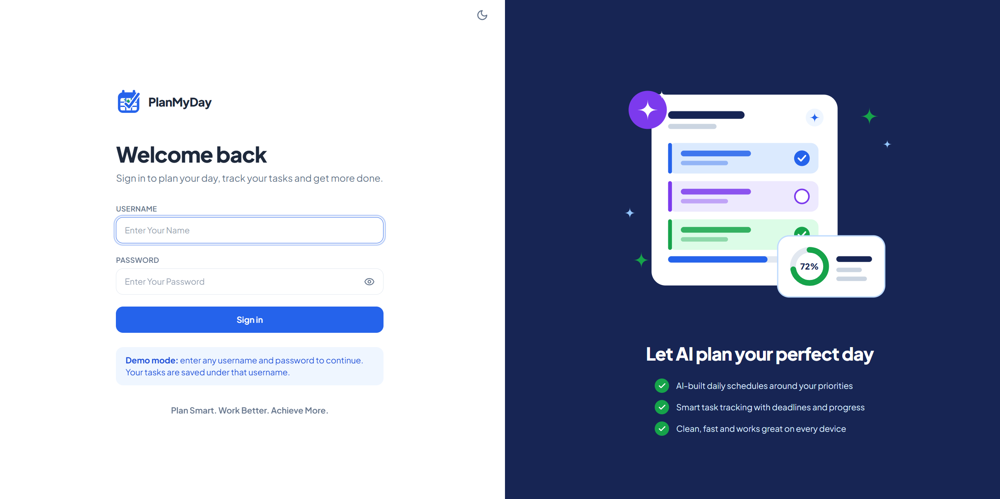
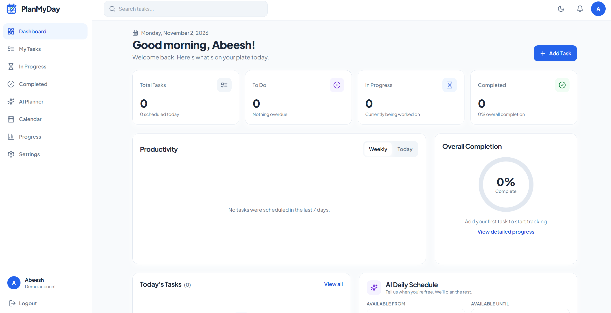

# PlanMyDay – AI-Powered Daily Planner

**Plan Smart. Work Better. Achieve More.**

PlanMyDay is an AI-powered productivity and task management application that helps users organize daily activities, manage tasks, monitor productivity, and generate intelligent daily schedules.

The application integrates OpenRouter AI to convert pending tasks into realistic daily schedules based on task priorities, deadlines, estimated durations, and available working hours. It automatically incorporates breaks to promote a balanced and productive workflow.

If the AI service is unavailable, the application uses a built-in priority-based scheduling algorithm to ensure that daily planning remains functional.

---

## 1. Project Description

PlanMyDay is designed to simplify daily planning and improve personal productivity through intelligent task management and automated scheduling.

The application provides a centralized platform where users can create and manage tasks, assign priorities, set deadlines, monitor completion progress, and organize their daily activities.

Its AI-powered scheduling system analyzes pending tasks and generates an optimized daily timeline while considering:

- Task priority and deadlines.
- Estimated task duration.
- Available working hours.
- Break intervals.
- Scheduling constraints.

The backend validates every AI-generated schedule before returning it to the frontend. If the AI service is unavailable or produces an invalid response, the application automatically switches to a built-in priority-based scheduling algorithm.

PlanMyDay combines task management, productivity analytics, calendar functionality, and intelligent scheduling in a responsive and user-friendly application.

## 2. Features

### 2.1 Authentication
- Demo login using any username and password.
- Personalized welcome message.
- Logout functionality.
- User-specific task management based on username.

### 2.2 Dashboard
- Personalized greeting and current date.
- Task statistics, including total, to-do, in-progress, and completed tasks.
- Visual task completion indicator.
- Daily productivity charts.
- Weekly productivity analytics.
- Overview of today's tasks.
- AI-powered daily schedule generator.

### 2.3 Task Management
- Create, edit, and delete tasks.
- Update task status.
- Assign task priorities.
- Set task deadlines.
- Filter tasks by status, priority, date, and search keywords.
- Sort tasks by deadline and priority.
- Dedicated pages for My Tasks, In Progress, and Completed.

### 2.4 AI-Powered Daily Planner
- Select a date for scheduling.
- Configure available working hours.
- Generate daily schedules using OpenRouter AI.
- Automatically include breaks between scheduled activities.
- Display explanations for task placement.
- Identify tasks that cannot fit within the available time.
- Regenerate schedules for alternative arrangements.
- Automatically use the fallback scheduling algorithm when AI is unavailable.

### 2.5 Calendar
- Interactive monthly calendar view.
- View tasks according to their scheduled dates.
- Navigate between calendar months.

### 2.6 Productivity Tracking
- Monitor daily task completion.
- Analyze weekly productivity trends.
- View priority-based task distribution.
- Track overall completion percentages.

### 2.7 Settings and Customization
- Light and dark themes.
- Customizable working hours.
- Backend connection testing.

### 2.8 Responsive Interface
- Responsive layouts for mobile, tablet, and desktop.
- Support for screen widths starting from 320px.
- Mobile navigation drawer.
- Consistent solid-color design without gradients.

---

## 3. Technology Stack

The application uses a modern full-stack architecture with React on the frontend, FastAPI on the backend, MongoDB for persistent storage, and OpenRouter for AI-powered scheduling.

| Layer | Technology | Purpose |
|---|---|---|
| Frontend | React 18 | Building the user interface |
| Build Tool | Vite | Frontend development and build |
| Styling | Tailwind CSS 3 | Responsive interface styling |
| Routing | React Router | Client-side navigation |
| HTTP Client | Axios | Backend API communication |
| Charts | Recharts | Productivity visualization |
| Icons | Lucide React | Interface icons |
| Backend | Python, FastAPI | REST API and business logic |
| Validation | Pydantic v2 | Request and response validation |
| Database | MongoDB | Persistent task storage |
| Database Driver | Motor | Asynchronous database operations |
| AI Integration | OpenRouter API | AI-powered schedule generation |
| Default AI Model | OpenAI GPT-4o-mini | Schedule generation |
| Testing | Pytest | Backend automated testing |
| Frontend Hosting | Vercel | Frontend deployment |
| Backend Hosting | Render | Backend deployment |
| Database Hosting | MongoDB Atlas | Cloud database hosting |

---

## 4. Project Architecture

PlanMyDay follows a client-server architecture that separates the frontend, backend, database, and AI integration responsibilities.

### 4.1 Frontend Layer

The frontend is developed using React 18 and Vite.

Responsibilities:
- Provides the user interface and navigation.
- Manages authentication and application state.
- Handles task creation and management.
- Displays productivity statistics and charts.
- Communicates with the backend through Axios.
- Displays AI-generated schedules and fallback results.

React Context is used to manage application-level state, including authentication, themes, tasks, notifications, and schedules.

### 4.2 Backend Layer

The backend is developed using FastAPI and Python.

Responsibilities:
- Exposes REST API endpoints.
- Handles task management operations.
- Validates incoming data using Pydantic v2.
- Calculates productivity statistics.
- Handles AI scheduling requests.
- Validates generated schedules.
- Provides fallback scheduling when AI is unavailable.

### 4.3 Database Layer

MongoDB is used for persistent data storage, with Motor providing asynchronous database access.

Database configuration:

| Property | Value |
|---|---|
| Database Name | `planmyday` |
| Collection Name | `tasks` |
| Database Driver | Motor |

Tasks are associated with usernames to provide basic user-level data separation.

### 4.4 AI Integration Layer

OpenRouter is integrated through the backend using its chat completions API.

The scheduling workflow:

1. The frontend submits the selected date and available working hours.
2. The backend retrieves the user's pending tasks.
3. Scheduling information is prepared and sent to OpenRouter.
4. The configured AI model generates a daily schedule.
5. The backend validates the generated schedule.
6. The validated schedule is returned to the frontend.
7. If AI generation fails or validation fails, the fallback scheduler generates an alternative schedule.

The validation process checks:
- Valid scheduling times.
- Compliance with available working hours.
- Overlapping time slots.
- References to existing tasks.
- Reasonable task durations.

The OpenRouter API key is stored exclusively on the backend and is never exposed to the frontend.

### 4.5 Application Architecture Diagram

```text
                 USER
                   |
                   v
             REACT FRONTEND
                   |
                   | Axios Requests
                   |
                   v
              FASTAPI BACKEND
                   |
          +--------+--------+
          |                 |
          v                 v
      MONGODB          AI PLANNER
          |                 |
          |                 v
          |             OPENROUTER
          |                 |
          |                 v
          |           AI RESPONSE
          |                 |
          |                 v
          |            VALIDATION
          |                 |
          |          +------+------+
          |          |             |
          |          v             v
          |       VALID AI      FALLBACK
          |       SCHEDULE      SCHEDULER
          |          |             |
          +----------+-------------+
                     |
                     v
              SCHEDULE RESPONSE
                     |
                     v
               REACT FRONTEND
                     |
                     v
                  USER
```

---

## 5. Folder Structure

```text
PlanMyDay/
│
├── render.yaml
│
├── backend/
│   ├── main.py
│   ├── database.py
│   ├── models.py
│   ├── auth.py
│   │
│   ├── routes/
│   │   ├── tasks.py
│   │   ├── progress.py
│   │   └── ai_planner.py
│   │
│   ├── services/
│   │   ├── openrouter.py
│   │   ├── scheduler.py
│   │   └── stats.py
│   │
│   ├── tests/
│   │   ├── test_scheduler.py
│   │   ├── test_stats.py
│   │   └── test_api.py
│   │
│   ├── requirements.txt
│   ├── requirements-dev.txt
│   └── .env.example
│
└── frontend/
    ├── vercel.json
    ├── tailwind.config.js
    ├── package.json
    ├── .env.example
    │
    └── src/
        ├── styles/
        │   └── index.css
        │
        ├── context/
        │   ├── auth
        │   ├── theme
        │   ├── toasts
        │   ├── tasks
        │   └── schedule
        │
        ├── services/
        │   ├── api.js
        │   └── auth.js
        │
        ├── components/
        ├── pages/
        ├── hooks/
        └── utils/
```

### Important Backend Files

| File | Responsibility |
|---|---|
| `main.py` | FastAPI application initialization, CORS, and health check |
| `database.py` | MongoDB connection and database dependency |
| `models.py` | Pydantic models and data validation |
| `auth.py` | Demo authentication using the username header |
| `routes/tasks.py` | Task management endpoints |
| `routes/progress.py` | Productivity statistics endpoints |
| `routes/ai_planner.py` | AI schedule generation endpoint |
| `services/openrouter.py` | OpenRouter API integration |
| `services/scheduler.py` | AI schedule validation and fallback scheduling |
| `services/stats.py` | Productivity statistics calculations |

---

## 6. Installation and Setup

### Prerequisites

Install the following before running the application:

- Python 3.11 or later
- Node.js 18 or later
- npm
- MongoDB or a MongoDB Atlas account
- Git

### Step 1: Clone the Repository

```bash
git clone <your-repository-url>
cd PlanMyDay
```

### Step 2: Backend Setup

Navigate to the backend directory:

```bash
cd backend
```

Create a Python virtual environment:

```bash
python -m venv .venv
```

Activate the virtual environment.

**Windows:**

```bash
.venv\Scripts\activate
```

**Linux/macOS:**

```bash
source .venv/bin/activate
```

Install backend dependencies:

```bash
pip install -r requirements.txt
```

Create the environment configuration file:

**Windows:**

```cmd
copy .env.example .env
```

**Linux/macOS:**

```bash
cp .env.example .env
```

Configure the required environment variables in `backend/.env`.

Start the backend server:

```bash
uvicorn main:app --reload --port 8000
```

Backend URL:

```text
http://localhost:8000
```

Interactive API documentation:

```text
http://localhost:8000/docs
```

### Step 3: Frontend Setup

Open another terminal and navigate to the frontend directory:

```bash
cd frontend
```

Create the frontend environment file.

**Windows:**

```cmd
copy .env.example .env
```

**Linux/macOS:**

```bash
cp .env.example .env
```

Install frontend dependencies:

```bash
npm install
```

Start the development server:

```bash
npm run dev
```

Frontend URL:

```text
http://localhost:5173
```

### Step 4: MongoDB Configuration

PlanMyDay supports both local MongoDB and MongoDB Atlas.

For MongoDB Atlas:

1. Create an account on MongoDB Atlas.
2. Create a free database cluster.
3. Create a database user.
4. Configure network access.
5. Copy the MongoDB connection string.
6. Add the connection string to the backend environment file.

The application uses the `planmyday` database and the `tasks` collection.

### Step 5: OpenRouter Configuration

OpenRouter integration is optional.

1. Create an account at [OpenRouter](https://openrouter.ai/).
2. Generate an API key.
3. Add the API key to the backend `.env` file.
4. Configure the desired AI model.

If the API key is unavailable or the AI service fails, the application automatically uses the built-in priority-based scheduling algorithm.

---

## 7. Environment Variables

### Backend Configuration

File: `backend/.env`

| Variable | Description | Example |
|---|---|---|
| `MONGODB_URL` | MongoDB connection string | `mongodb://localhost:27017` |
| `DATABASE_NAME` | MongoDB database name | `planmyday` |
| `OPENROUTER_API_KEY` | OpenRouter API key | Optional |
| `OPENROUTER_MODEL` | OpenRouter model identifier | `openai/gpt-4o-mini` |
| `CORS_ORIGINS` | Allowed frontend origins | `http://localhost:5173` |
| `CORS_ORIGIN_REGEX` | Optional regex for allowed frontend origins | `https://planmyday.*\.vercel\.app` |

### Frontend Configuration

File: `frontend/.env`

| Variable | Description | Example |
|---|---|---|
| `VITE_API_URL` | Backend API base URL | `http://localhost:8000` |

**Security Considerations:**

- Never commit `.env` files to GitHub.
- Keep the OpenRouter API key exclusively on the backend.
- Do not expose private credentials through frontend environment variables.
- Configure production CORS origins carefully.
- Use secure authentication before deploying for real users.

---

## 8. API Endpoints

All endpoints except `/health` require the `X-Username` HTTP request header.

### 8.1 Task Management

| Method | Endpoint | Description |
|---|---|---|
| POST | `/tasks` | Create a new task |
| GET | `/tasks` | Retrieve tasks with optional filters |
| GET | `/tasks/{id}` | Retrieve a specific task |
| PUT | `/tasks/{id}` | Update an existing task |
| PATCH | `/tasks/{id}/status` | Update task status |
| DELETE | `/tasks/{id}` | Delete a task |

**Supported Query Parameters:**

| Parameter | Description |
|---|---|
| `status` | Filter by task status |
| `priority` | Filter by task priority |
| `date` | Filter by date |
| `q` | Search tasks by keyword |
| `sort_by` | Sort by deadline or priority |
| `order` | Specify ascending or descending order |

**Supported Task Statuses:**

- `Todo`
- `In Progress`
- `Done`

### 8.2 Productivity Statistics

| Method | Endpoint | Description |
|---|---|---|
| GET | `/progress?date=` | Retrieve productivity statistics |

The response includes:

- Total task count.
- Completion percentage.
- Today's task statistics.
- Seven-day productivity data.
- Priority-based task breakdown.

### 8.3 AI Schedule Generation

| Method | Endpoint | Description |
|---|---|---|
| POST | `/ai/generate-schedule` | Generate a daily schedule |

**Example Request:**

```json
{
  "date": "2026-11-02",
  "start_time": "09:00",
  "end_time": "17:00",
  "notes": "Focus on important tasks",
  "regenerate": false
}
```

**Request Parameters:**

| Parameter | Description |
|---|---|
| `date` | Date for schedule generation |
| `start_time` | Available working hours start time |
| `end_time` | Available working hours end time |
| `notes` | Optional scheduling instructions |
| `regenerate` | Request an alternative schedule |

The response contains the generated timeline, scheduled tasks, break intervals, task placement explanations, and tasks that could not fit.

If AI generation fails, the backend returns a fallback schedule with a warning explaining the issue.

### 8.4 Health Check

| Method | Endpoint | Description |
|---|---|---|
| GET | `/health` | Check backend and database connectivity |

**Example Response:**

```json
{
  "status": "ok",
  "database": "connected"
}
```

---

## 9. Testing

The backend includes automated tests using Pytest.

Install the development dependencies:

```bash
cd backend
pip install -r requirements-dev.txt
```

Run the test suite:

```bash
pytest
```

The tests cover:

- Scheduling algorithm functionality.
- Productivity statistics calculations.
- Backend API operations.

---

## 10. Deployment

PlanMyDay uses MongoDB Atlas, Render, and Vercel for deployment.

### 10.1 Database Deployment – MongoDB Atlas

1. Create a MongoDB Atlas account.
2. Create a free cluster.
3. Configure database access and network permissions.
4. Obtain the MongoDB connection string.
5. Configure `MONGODB_URL` in the backend deployment environment.

### 10.2 Backend Deployment – Render

1. Connect the GitHub repository to Render.
2. Select **New → Blueprint**.
3. Choose the repository containing `render.yaml`.
4. Configure the required environment variables.
5. Set `CORS_ORIGINS` to the deployed frontend URL.
6. Deploy the backend service.

Verify the deployment:

```text
https://<your-service>.onrender.com/health
```

The health endpoint should report a connected database.

### 10.3 Frontend Deployment – Vercel

1. Import the GitHub repository into Vercel.
2. Set the Root Directory to `frontend`.
3. Configure the `VITE_API_URL` environment variable.
4. Set its value to the deployed Render backend URL.
5. Deploy the frontend.

Finally, update the backend's `CORS_ORIGINS` with the deployed Vercel URL and redeploy the backend if required.

**Deployment Notes:**

- Render's free plan may put inactive services to sleep.
- The first request after inactivity may take longer.
- Vercel preview URLs can differ between deployments.
- Configure `CORS_ORIGIN_REGEX` if preview deployment URLs need to be allowed.

---

## 11. Demo Authentication

The current application uses demo authentication.

Users can log in using any username and password. Tasks are associated with the entered username, allowing basic separation of task data.

Authentication is implemented in:

- `backend/auth.py`
- `frontend/src/services/auth.js`

**Important:** Demo authentication is not secure and should not be used for production applications. Anyone entering an existing username can access the tasks associated with that username.

The authentication implementation is isolated so that secure authentication, such as JWT-based authentication, can be introduced in future versions.

---
## Application Screenshots

### LoginPage


### Task Management


---

## 12. Future Improvements

The following improvements are planned for future versions of PlanMyDay:

1. **Secure Authentication:** Implement user registration, password hashing, JWT authentication, and protected routes.

2. **Advanced AI Scheduling:** Improve scheduling using task dependencies, dynamic priorities, estimated effort, and user productivity patterns.

3. **Smart Notifications:** Introduce email, browser, and push notifications for upcoming deadlines and scheduled tasks.

4. **Calendar Integration:** Integrate Google Calendar and other calendar platforms for event synchronization.

5. **Recurring Tasks:** Support daily, weekly, monthly, and custom recurring tasks.

6. **Team Collaboration:** Enable task sharing, team assignments, and collaborative planning.

7. **Advanced Analytics:** Provide detailed productivity reports, time utilization analysis, and personalized insights.

8. **Mobile Application:** Develop dedicated Android and iOS applications.

9. **Offline Support:** Allow task management without an internet connection and synchronize changes when connectivity is restored.

10. **Data Export:** Support exporting tasks and productivity reports in CSV and PDF formats.

11. **Personalized AI Recommendations:** Analyze productivity patterns and suggest improvements to daily schedules.

---

## 13. License

The project license has not yet been specified.

For an open-source release, the MIT License can be considered.

If you choose the MIT License, add a `LICENSE` file to the root directory of the repository containing the complete standard MIT License text.

---

## Conclusion

PlanMyDay brings task management, productivity tracking, and AI-powered scheduling together in a single application.

By combining React, FastAPI, MongoDB, and OpenRouter, the project provides an intelligent and flexible approach to daily planning.

Its AI scheduling capabilities, automatic fallback mechanism, and responsive interface help users organize their work, manage time effectively, and maintain a consistent productivity workflow.

**PlanMyDay – Plan Smart. Work Better. Achieve More.**
